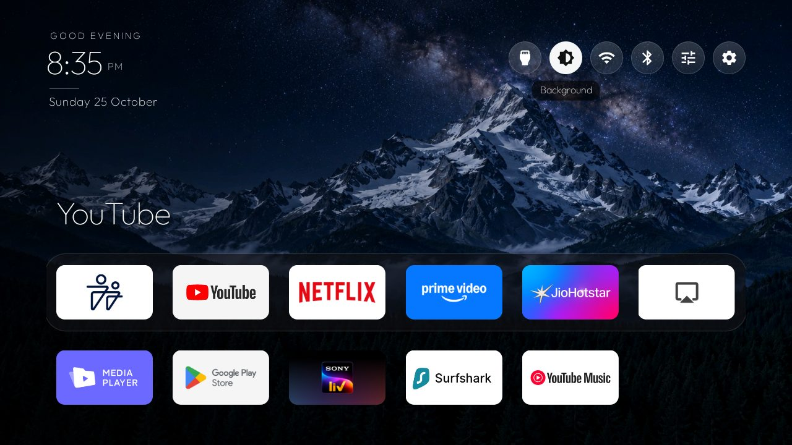
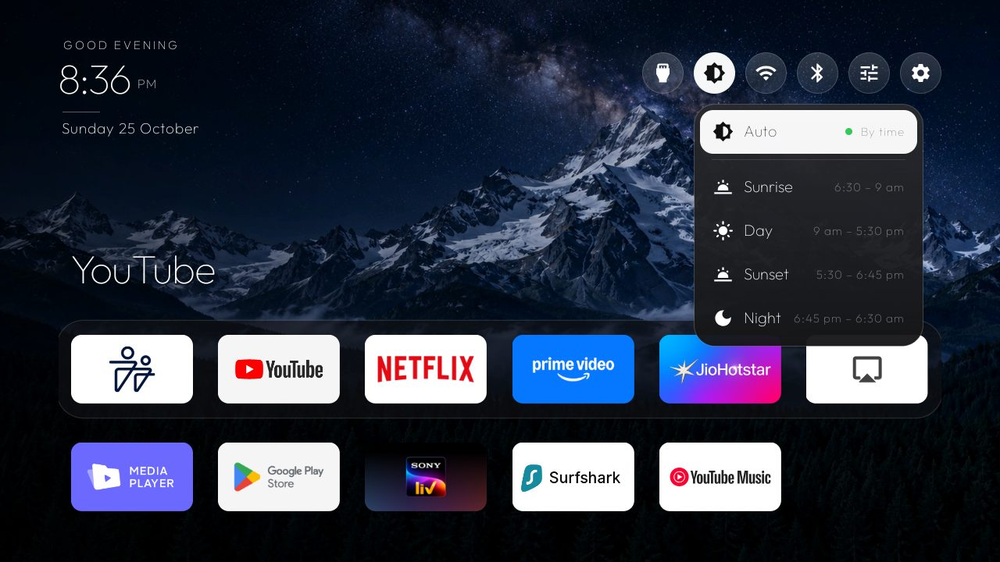
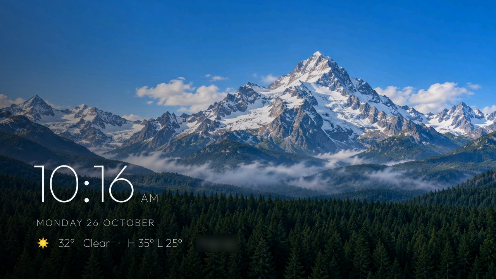

# Time-of-day home and weather screensaver

A fork of the tv-vibehack launcher, built and tested on a **Xiaomi MiTV-AXSO0, Android TV 9 (PI.6036)**.
Everything is in `launcher/`. Build and install it the usual way:
`TV_HOST=<tv ip> launcher/build-and-install.sh`.



## What it changes

- **A background that follows the time of day.** Four built-in pictures (Sunrise, Day, Sunset, Night) change
  on their own: 6:30 to 9 am, 9 am to 5:30 pm, 5:30 to 6:45 pm, and 6:45 pm to 6:30 am. The pictures
  cross-fade, and the time is checked once a minute. A theme's own wallpaper still wins.
- **A Background button** in the top bar picks **Auto** (by time) or one picture all day. Each choice shows
  its hours.

  

- **Round icon-only buttons** at the top right: Inputs, Background, Wi-Fi, Bluetooth, Picture & Sound and
  Settings. The name of the focused button shows in a small caption underneath.
- **A Bluetooth button** that opens Android TV's pairing screen and the TV maker's sound-output picker. Both
  are set in `config.xml` (`bluetooth_pair`, `bluetooth_output`), and the button hides when neither opens.
- **Layout:** a smaller clock, date and menus; the dock sits lower with less of a gap; the app name shows
  above the dock for the lower row too; and the dock band is see-through.
- **Readability:** a soft shade on the left and top, plus text shadows, keep white text clear on a bright
  sky. The app-colour glow is hidden while a wallpaper shows.
- **Screensaver ("Clock & weather"):** the same time-of-day picture, zooming very slowly, with the clock,
  date and weather in the lower left. The text shifts a little every minute.

  

## Weather

Weather comes from [Open-Meteo](https://open-meteo.com), which is free and needs no key. It refreshes every
30 minutes, and the last reading stays for up to 3 hours offline. It is **off until you set your town** in
`launcher/app/src/main/res/values/config.xml`:

```xml
<string name="weather_lat" translatable="false">51.51</string>
<string name="weather_lon" translatable="false">-0.13</string>
<string name="weather_place" translatable="false">London</string>
```

This is why the fork is not in the main launcher: it adds the `INTERNET` permission, and the four
pictures make the APK about 1.3 MB.

## Notes

- The Picture & Sound and Bluetooth sound-output entries in `config.xml` are Xiaomi's screens. On another
  TV, change them or leave them empty.
- The four pictures were generated with ChatGPT and fitted to 1600×900 JPEG. `tools/sky_wallpapers.py`
  paints a procedural set instead, if you'd rather make your own.
